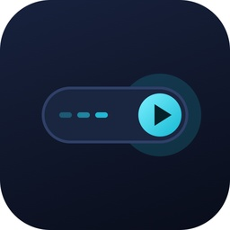
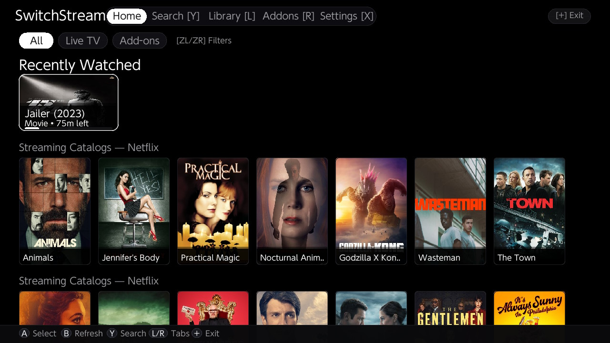
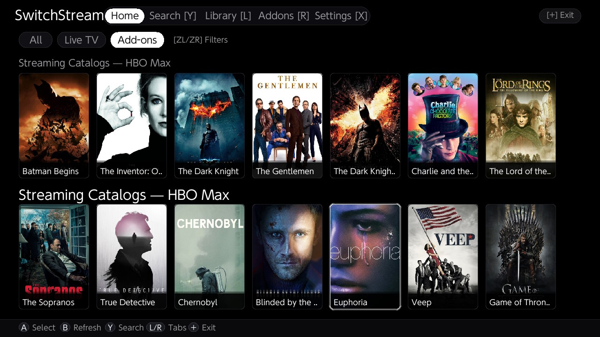
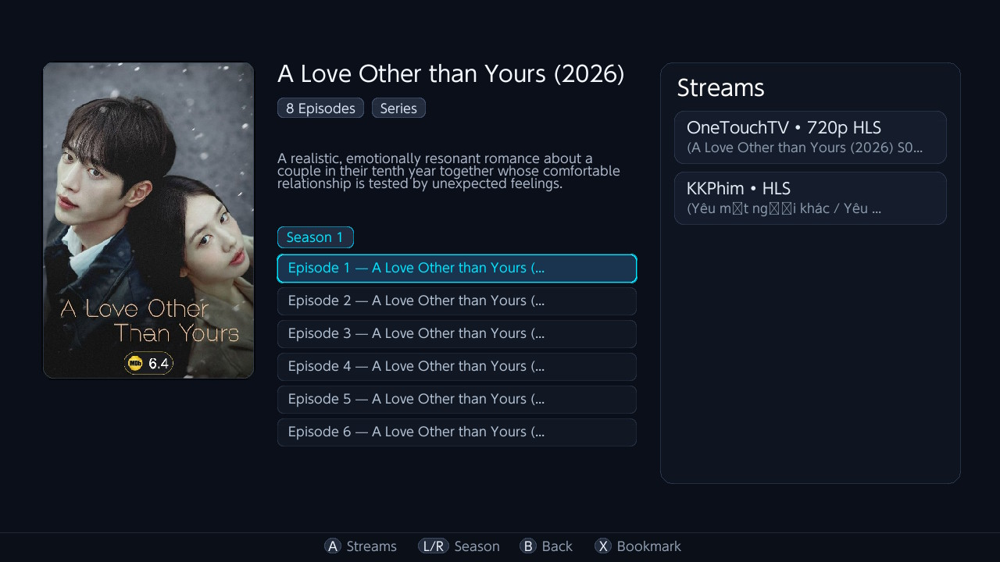
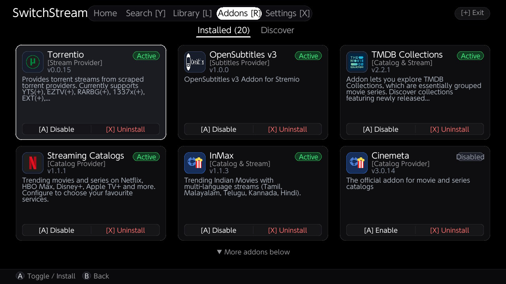
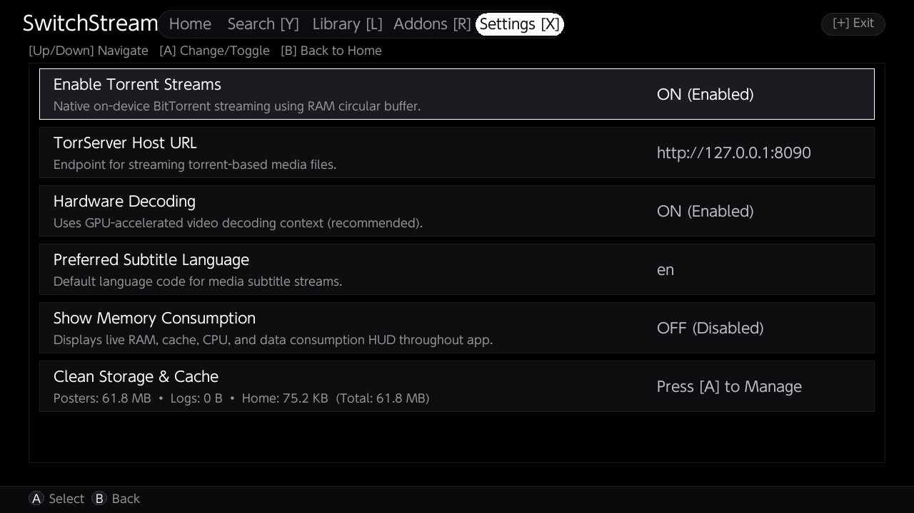
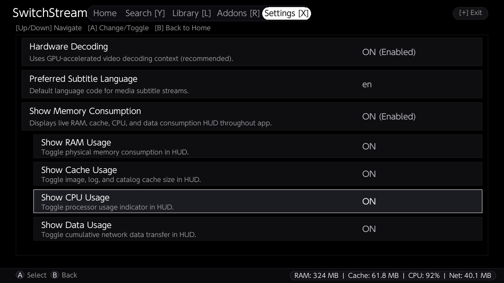

# SwitchStream

<p align="center">
  
</p>

<h3 align="center">A Modern, High-Performance Stremio Media Center for Nintendo Switch</h3>

<p align="center">
  <a href="https://github.com/senkuObito/switchStream/releases/latest"></a>
  
  
  
</p>

---

**SwitchStream** brings the complete [Stremio](https://www.strem.io/) streaming ecosystem directly to the **Nintendo Switch**. Built natively with raw SDL2 and `libmpv`, SwitchStream delivers lightning-fast catalog navigation, RAM-buffered BitTorrent streaming, direct HTTP/HLS video playback, local video viewing, and universal multi-addon search—all tailored for both handheld and docked play.

---

## 📸 Screenshots (Captured Directly on Nintendo Switch)

| Continue Watching & Home Catalog | Category Filter Navigation |
|:---:|:---:|
|  |  |
| *Pinned "Recently Watched" row at the top with watch progress bars & Netflix catalog* | *Instant category filter pills ([All], [Live TV], [Add-ons]) and HBO Max catalog* |

| Media Detail & Stream Providers | Installed Addons Manager |
|:---:|:---:|
|  |  |
| *Episodes list, IMDb badge, synopsis, and parallel stream resolvers (720p/1080p HLS)* | *Manage community & official addons: Torrentio, OpenSubtitles, TMDB, Streaming Catalogs* |

| Direct Torrent Streaming & Video Engine | Real-Time Performance HUD & Settings |
|:---:|:---:|
|  |  |
| *Enable on-device BitTorrent streaming in RAM, TorrServer URL, and Tegra X1 GPU decoding* | *Live HUD overlay monitoring RAM, Cache, CPU usage, and network data transfer* |

---

## ✨ Main Features in v2.0.0

### ⚡ Direct Torrent Streaming (In-Memory RAM Buffer)
- **Native BitTorrent Engine**: Stream torrents directly on your Nintendo Switch into an in-memory circular RAM buffer (`torrentfs`) with intelligent piece prioritization (head and tail pieces first).
- **Zero SD Card Wear**: Video blocks are buffered dynamically in RAM, preserving the lifespan of your Switch micro-SD card.
- **Enable via Settings**: Open Settings (`[X]` on Home) and toggle **Enable Torrent Streams** to **`ON (Enabled)`**.
- **TorrServer Integration**: Seamlessly switch between native on-device torrent streaming and an internal/external TorrServer instance (`http://127.0.0.1:8090`).

### 🎮 Enhanced Video Player Experience
- **5-Second Joy-Con Skips**: Tap Left / Right on the D-Pad or Joy-Cons to skip 5 seconds backward or forward.
- **Dynamic Seek Delta Badge**: Displays cumulative jump time (`+5s`, `+10s`, `-15s`) that automatically aggregates on rapid button taps.
- **Long Press `[R]` for 2x Fast-Forward**: Hold down the **`[R]`** bumper/trigger during video playback to fast-forward at smooth 2x speed.
- **Dual-Side Touch Gestures**:
  - **Swipe Up/Down on Right Side**: Adjust audio volume smoothly.
  - **Swipe Up/Down on Left Side**: Adjust screen brightness smoothly.
  - **Timeline Scrub**: Touch and drag along the player progress bar to seek with real-time delta indicators.
- **Subtitles & Audio Track Picker**: Switch subtitle languages (embedded and OpenSubtitles v3) and cycle audio tracks on the fly with `[Y]` and `[X]`.

### 📌 Continue Watching Pinned at the Top
- **Prominent Top Placement**: The "Recently Watched" row is pinned directly at the top of the Home feed for instant access to your active shows and movies.
- **Visual Progress & Time Remaining**: Displays colored progress bars and exact runtime left (e.g. `Movie • 75m left`).
- **One-Click Resume**: Click `[A]` on any recently watched item to resume playback exactly where you left off.

### 🌏 C-Drama & K-Drama Addon Support
- **Asian Streaming Providers**: Built-in compatibility and discovery for popular C-Drama and K-Drama addons (Dramayo, K-Drama Crush, KissKH, Asian stream scrapers).
- **Dedicated Category Filters**: Quick category filtering for Asian Dramas and regional content using `[ZL]` / `[ZR]` or touch filter pills.

### 📁 Local Video Viewing
- **Offline SD Card Playback**: Drop personal video files (`.mp4`, `.mkv`, `.avi`, `.mov`) into:
  ```
  sdmc:/switch/switchstream/videos/
  ```
- **Unified Catalog & Search**: Local files are automatically scanned with thumbnail generation, watch history tracking, and global search inclusion.

### 🔍 Universal Multi-Addon Search & Bug Fixes
- **Multi-Threaded Parallel Search**: Press `[Y]` anywhere to open the native on-screen keyboard and search across all installed addons concurrently.
- **Client-Side Token Matching**: Intelligent multi-token matching catches titles from catalog providers that lack server-side search endpoints.
- **Provider Deduplication**: Combines identical movies and series across multiple addons into a single unified card showing all available stream sources.
- **Fixed Stream Resolvers**: Resolved stream aggregation fallback so addons like Streaming Catalogs properly query all installed stream scrapers (Torrentio, WebStream, FilTorrent, TorrentsDB, etc.).

### 🎨 Enhanced Catalog Loading Logic & 3D Pill Spinner
- **3D Pill Breathing Indicator**: Smooth, GPU-composited 3D pill loading animation with pulsing breathing effect.
- **Asynchronous Lazy Loading**: Multi-threaded non-blocking catalog fetching prevents UI hitching and memory bottlenecks when browsing extensive media libraries.

### 📺 Indian Live TV (250+ Channels)
- **24/7 Verified Live TV**: Direct HLS streaming for 250+ Indian Live TV channels from Zee5, SonyLIV, and MX Player with instantaneous start times and zero buffering.

### 📊 Real-Time Performance HUD & Cache Storage Cleaner
- **Live Diagnostics Overlay**: Real-time HUD displaying physical RAM consumption, poster cache size, CPU utilization, and network data throughput.
- **Granular Storage Cleaner**: View exact disk consumption of cached posters, logs, and home metadata in Settings (`[X]`), with one-touch cache clearing.
- **Title Takeover Protection**: Warns if launched under Album/Applet Mode (restricted to 400MB) to ensure full 3.5GB RAM access for high-definition playback.

---

## 🕹️ Controls Reference

### Navigation & Discovery
| Button | Screen | Action |
|:---:|:---:|:---|
| **D-Pad / Left Stick** | All | Navigate cards, items, and menus |
| **[A]** | All | Select / Open detail / Play stream |
| **[B]** | All | Back / Cancel / Return to Home |
| **[Y]** | Home / Search | Open on-screen keyboard search |
| **[X]** | Home / Detail | Toggle Bookmark / Open Settings |
| **[L] / [R]** | Home | Jump to Library / Jump to Addons |
| **[ZL] / [ZR]** | Home | Cycle category filter pills (*All*, *Live TV*, *Add-ons*, etc.) |
| **[L] / [R]** | Detail | Switch between TV seasons |
| **[+]** | All | Safely exit SwitchStream |

### In-Player Playback Controls
| Control | Action |
|:---:|:---|
| **[A]** | Play / Pause video |
| **Left / Right (D-Pad or Joy-Con)** | Skip backward / forward 5 seconds |
| **Hold [R] (Long Press)** | Fast-forward at **2x speed** |
| **Up / Down (D-Pad)** | Adjust audio volume ±5% |
| **[Y]** | Open Subtitles selector (Embedded & OpenSubtitles) |
| **[X]** | Open Audio Tracks selector |
| **[B]** | Stop playback and return to media details |

### Touchscreen Gestures
- **Tap Element**: Select or activate any poster, episode, or button directly.
- **Horizontal Swipe**: Scroll through catalog rows and category feeds smoothly.
- **Swipe Up / Down (Left Half)**: Adjust display brightness.
- **Swipe Up / Down (Right Half)**: Adjust audio volume.
- **Timeline Scrubbing**: Drag along the player progress bar to jump to any timestamp.
- **Category Filter Pills**: Tap any pill (*All*, *Live TV*, *Add-ons*) to filter instantly.

---

## 📦 Installation

### Requirements
- A Nintendo Switch running custom firmware (**Atmosphère**).
- **Application Mode (Title Takeover)**: Hold **[R]** while launching any installed game from the Switch home menu to launch the Homebrew Menu.  
  *(Do NOT launch from the Album applet to ensure full 3.5GB RAM access for video decoding).*

### Quick Install
1. Download **`switchstream.nro`** from the [GitHub Releases](https://github.com/senkuObito/switchStream/releases/latest) page.
2. Copy `switchstream.nro` to your SD card at:
   ```
   sdmc:/switch/switchstream/switchstream.nro
   ```
3. *(Optional)* Place personal offline videos into:
   ```
   sdmc:/switch/switchstream/videos/
   ```
4. *(Optional for Torrents)* Open **Settings** (`[X]`) and toggle **Enable Torrent Streams** to **`ON`**.
5. Launch **SwitchStream** through the Homebrew Menu and enjoy!

---

## 🛠️ Building from Source

### Prerequisites
Install [devkitPro](https://devkitpro.org/) with the required Nintendo Switch homebrew packages:

```bash
sudo dkp-pacman -S switch-dev switch-sdl2 switch-sdl2_ttf \
    switch-sdl2_image switch-freetype switch-curl \
    switch-mbedtls switch-zlib switch-libpng switch-libjpeg-turbo
```

### Compile
Clone the repository and compile with `make`:

```bash
git clone https://github.com/senkuObito/switchStream.git
cd switchStream

# Build switchstream.nro with multi-core compilation
make -j$(nproc)
```

### Deploy to Switch (FTP / nxlink)
```bash
# Upload directly via curl FTP (when ftpd is running on Switch)
curl -T switchstream.nro ftp://<SWITCH_IP>:5000/switch/switchstream/switchstream.nro

# Or upload over network using nxlink
nxlink --address <SWITCH_IP> switchstream.nro
```

---

## 🧩 Architecture

```
source/
├── main.cpp              # Entry point, memory limits, RomFS & crash handlers
├── app.h / app.cpp       # Application state machine, SDL2 renderer & gesture handler
├── core/
│   ├── addon_client      # Stremio JSON protocol & manifest parser
│   ├── addon_manager     # Multi-addon stream aggregator, catalog loader, search engine
│   └── library           # Watch history, resume timestamps, and bookmarks
├── net/
│   ├── http_client       # Multi-threaded libcurl networking wrapper
│   └── image_cache       # Thread-safe disk & memory poster caching
├── player/
│   ├── player.h / .cpp   # libmpv hardware video player & custom OSD
│   └── curl_stream.cpp   # Custom stream reader for mpv
└── torrent/
    ├── torrentfs.c       # In-memory BitTorrent piece caching engine
    └── torrent_stream.cpp# High-speed BitTorrent stream bridge
```

---

## 📄 License
This project is licensed under the **MIT License** — see the [LICENSE](LICENSE) file for details.

---

<p align="center">Made with ❤️ for the Nintendo Switch Homebrew Community</p>
