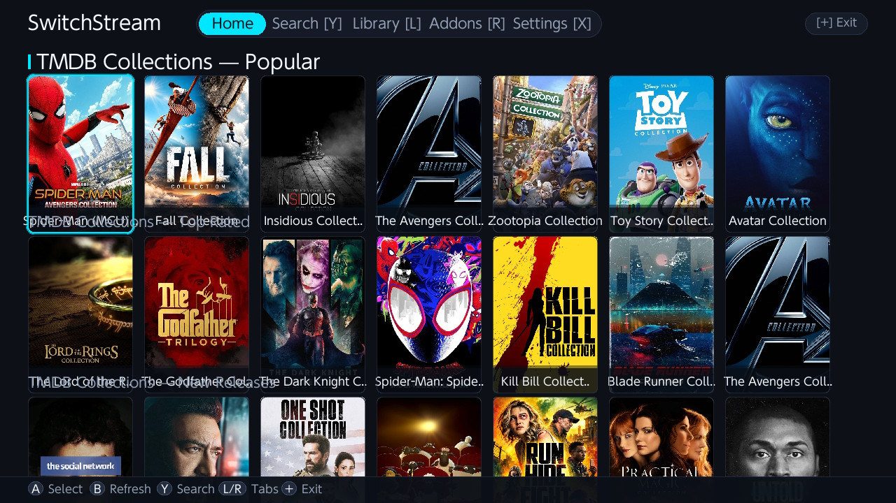
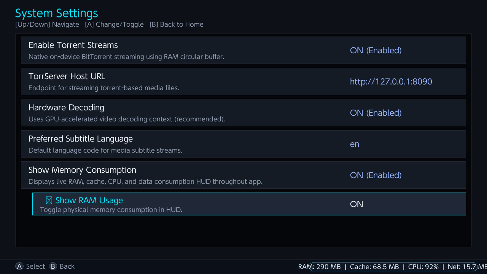
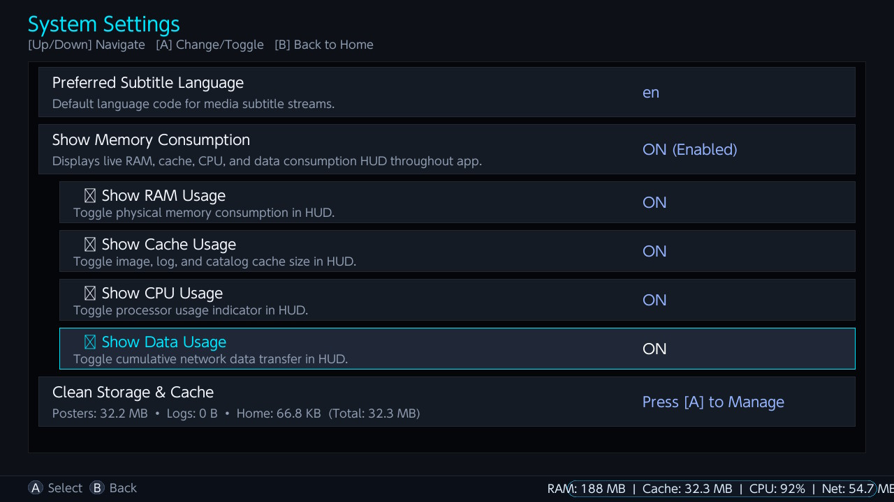

# SwitchStream

<p align="center">
  
</p>

<h3 align="center">A Modern, High-Performance Stremio Media Center for Nintendo Switch</h3>

<p align="center">
  <a href="https://github.com/senkuObito/switchStream/releases/latest"></a>
  
  
  
</p>

---

**SwitchStream** brings the complete [Stremio](https://www.strem.io/) streaming ecosystem directly to the **Nintendo Switch**. Built natively with raw SDL2 and `libmpv`, SwitchStream delivers lightning-fast catalog navigation, RAM-buffered BitTorrent streaming, direct HTTP/HLS video playback, and universal multi-addon search—all tailored for both handheld and docked play.

---

## 📸 Screenshots (Captured Directly on Nintendo Switch)

| Home Catalog Feed | Media Detail & Stream Sources |
|:---:|:---:|
|  |  |
| *Curated catalog rows, category filters, and high-res poster navigation* | *Full synopsis, season selector, IMDb ratings, and parallel stream resolver* |

| Engine Settings & Hardware Acceleration | Performance HUD & Storage Cleaner |
|:---:|:---:|
|  |  |
| *BitTorrent circular buffer, TorrServer host, and Tegra X1 GPU decoding* | *Real-time RAM/CPU/Data overlay toggles and granular disk cache management* |

---

## ✨ Features

### 🎬 Stremio Ecosystem & Catalog Discovery
- **Universal Addon Support**: Aggregates official and community Stremio addons (Cinemeta, YaStream, Streaming Catalogs, TMDB Collections, Dramayo, K-Drama Crush, AnimeStream, WebStreamr, and more).
- **Curated Horizontal Rows**: Browse popular movies, trending series, anime, and collections with responsive navigation and lazy-loaded posters.
- **Quick Category Filter Pills**: Tap or cycle (`[ZL]` / `[ZR]`) between *All*, *Movies*, *Series*, *Asian & K-Dramas*, and *Live TV*.
- **Continue Watching with Auto-Resume**: Automatically stores playback progress, highlights watched items with colored completion bars, and resumes playback with one click.
- **Local Media Library**: Automatically indexes offline video files placed in `sdmc:/switch/switchstream/videos/` alongside online feeds.

### 🔍 Universal Multi-Addon Search
- **Global Parallel Query**: Press `[Y]` anywhere to launch the native Switch on-screen keyboard and search across all enabled addons concurrently.
- **Client-Side Token Matching**: Intelligent multi-word fuzzy matching surfaces catalog items even when external providers lack server-side search endpoints.
- **Deduplication Engine**: Merges duplicate movie and series listings across providers into a unified title card.
- **Local Media Search**: Seamlessly searches local SD card videos alongside online stream catalogs.

### ⚡ Streaming Engines & High-Performance Playback
- **Tegra X1 Hardware Video Decoding**: Uses hardware-accelerated decoding contexts in `libmpv` for smooth 720p and 1080p playback without frame drops.
- **RAM-Based BitTorrent Streaming**: Native on-device BitTorrent engine streaming into a circular RAM buffer (`torrentfs`) with head/tail piece prioritization—stream torrents without flash memory wear on your SD card.
- **Direct HTTP & HLS Pipelines**: Fast video pipelines for WebStreamr, OneTouchTV, Dramayo, VidSrc, KissKH, MovieBox, and YouTube streams.
- **Indian Live TV (250+ Channels)**: Direct access to 24/7 Live TV streams from Zee5, SonyLIV, and MX Player with instant start times and zero buffering.
- **TorrServer Endpoint Support**: Option to route torrent streams through an internal or external TorrServer instance (`http://127.0.0.1:8090`).

### 🎮 Modern Touch & Gamepad Video Player
- **Interactive On-Screen Display (OSD)**: Displays current time, remaining time, buffer health percentage, and live download bitrate.
- **Accumulating Seek Badges**: Visual indicator (`+5s`, `-10s`, etc.) shows exact time jumped on rapid D-pad or bumper presses.
- **Dual-Side Touch Gestures**:
  - **Left Side Swipe Up/Down**: Adjust display brightness smoothly.
  - **Right Side Swipe Up/Down**: Adjust audio volume smoothly.
  - **Scrub Bar Drag**: Tap or drag along the progress bar to instantly jump to any timestamp.
- **Subtitles & Audio Track Switcher**: On-the-fly subtitle language picker (embedded and OpenSubtitles v3) and audio track switcher (`[Y]` and `[X]`).

### 📊 System Diagnostics & Storage Management
- **Real-Time Performance HUD**: Toggleable on-screen monitor showing physical RAM usage, image cache memory, CPU utilization percentage, and cumulative network data transfer.
- **Granular Storage Cleaner**: View exact SD card disk space consumed by cached posters, logs, and home metadata, with one-click cache clearing.
- **Title Takeover Protection**: Detects and alerts if the app is launched in Applet Mode (restricted to 400MB) to ensure users always run in Application Mode with full 3.5GB RAM access.

---

## 🕹️ Controls

### Gamepad Navigation
| Button | Screen | Action |
|:---:|:---:|:---|
| **D-Pad / Left Stick** | All | Navigate cards, items, and menus |
| **[A]** | All | Select / Open detail / Play stream |
| **[B]** | All | Back / Cancel / Return to Home |
| **[Y]** | Home / Search | Open on-screen keyboard search |
| **[X]** | Home / Detail | Toggle Bookmark / Open Settings |
| **[L] / [R]** | Home | Jump to Library / Jump to Addons |
| **[ZL] / [ZR]** | Home | Cycle category filter pills (*All*, *Movies*, *Series*, etc.) |
| **[L] / [R]** | Detail | Switch between TV seasons |
| **[+]** | All | Safely exit SwitchStream |

### In-Player Controls
| Button | Action |
|:---:|:---|
| **[A]** | Play / Pause video |
| **Left / Right** | Seek backward / forward 10 seconds |
| **Up / Down** | Adjust audio volume ±5% |
| **[Y]** | Open Subtitles menu |
| **[X]** | Open Audio Tracks menu |
| **[B]** | Stop playback and return to detail screen |

### Touchscreen Gestures
- **Tap Card / Button**: Select or activate any interface element directly.
- **Horizontal Swipe**: Scroll through catalog poster rows and categories.
- **Left Half Vertical Swipe**: Adjust screen brightness up or down.
- **Right Half Vertical Swipe**: Adjust audio volume up or down.
- **Timeline Scrub**: Drag along the player progress bar to jump to any timestamp.
- **Filter Pills**: Tap any category pill (*All*, *Movies*, *Series*, *Live TV*) to filter instantly.

---

## 📦 Installation

### Requirements
- A Nintendo Switch running custom firmware (**Atmosphère**).
- **Application Mode (Title Takeover)**: Hold **[R]** while launching any installed game from the Switch home menu to open the Homebrew Menu.  
  *(Do NOT launch from the Album applet to ensure full 3.5GB RAM access for video decoding).*

### Quick Install
1. Download the latest **`switchstream.nro`** from the [GitHub Releases](https://github.com/senkuObito/switchStream/releases/latest) page.
2. Place `switchstream.nro` onto your SD card at:
   ```
   sdmc:/switch/switchstream/switchstream.nro
   ```
3. *(Optional)* Place personal offline videos into:
   ```
   sdmc:/switch/switchstream/videos/
   ```
4. Launch **SwitchStream** through the Homebrew Menu and enjoy!

---

## 🛠️ Building from Source

### Prerequisites
Install [devkitPro](https://devkitpro.org/) with the required Nintendo Switch homebrew packages:

```bash
sudo dkp-pacman -S switch-dev switch-sdl2 switch-sdl2_ttf \
    switch-sdl2_image switch-freetype switch-curl \
    switch-mbedtls switch-zlib switch-libpng switch-libjpeg-turbo
```

### Compile
Clone the repository and compile with `make`:

```bash
git clone https://github.com/senkuObito/switchStream.git
cd switchStream

# Build switchstream.nro with multi-core compilation
make -j$(nproc)
```

### Deploy to Switch (FTP / nxlink)
```bash
# Upload directly via curl FTP (when ftpd is running on Switch)
curl -T switchstream.nro ftp://<SWITCH_IP>:5000/switch/switchstream/switchstream.nro

# Or upload over network using nxlink
nxlink --address <SWITCH_IP> switchstream.nro
```

---

## 🧩 Architecture

```
source/
├── main.cpp              # Entry point, memory limits, RomFS & crash handlers
├── app.h / app.cpp       # Application state machine, SDL2 renderer & gesture handler
├── core/
│   ├── addon_client      # Stremio JSON protocol & manifest parser
│   ├── addon_manager     # Multi-addon stream aggregator, catalog loader, search engine
│   └── library           # Watch history, resume timestamps, and bookmarks
├── net/
│   ├── http_client       # Multi-threaded libcurl networking wrapper
│   └── image_cache       # Thread-safe disk & memory poster caching
├── player/
│   ├── player.h / .cpp   # libmpv hardware video player & custom OSD
│   └── curl_stream.cpp   # Custom stream reader for mpv
└── torrent/
    ├── torrentfs.c       # In-memory BitTorrent piece caching engine
    └── torrent_stream.cpp# High-speed BitTorrent stream bridge
```

---

## 📄 License
This project is licensed under the **MIT License** — see the [LICENSE](LICENSE) file for details.

---

<p align="center">Made with ❤️ for the Nintendo Switch Homebrew Community</p>
